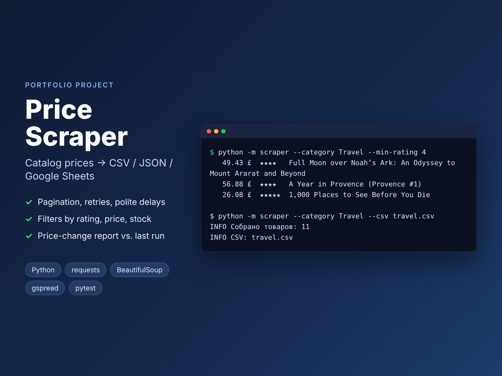

# Price Scraper: catalog prices to CSV, JSON and Google Sheets



A command-line scraper for an online catalog. It collects products with price, rating, stock status and link, filters them, and exports the result to CSV (Excel-friendly), JSON or a Google Sheet. It can also compare the result with the previous run to show new products, removed products and price changes. This is the typical "price monitoring" task.

The target site is [books.toscrape.com](https://books.toscrape.com), a public sandbox made for practicing web scraping. The code is split so that switching to another site mostly means rewriting `parser.py`.

> Portfolio project. It is covered by tests that run on saved HTML (no network access needed).

**Stack:** Python 3.11+ · requests (with retries) · BeautifulSoup4 · gspread (Google Sheets API) · argparse · pytest · GitHub Actions

## Features

- Goes through the whole catalog or one category, following "next" pages
- Polite crawling: delay between requests, timeouts, automatic retries with backoff on 429/5xx
- Survives a broken product card (skips it instead of crashing) and removes duplicates
- Filters: `--min-rating`, `--max-price`, `--in-stock`
- Export to CSV (UTF-8 with BOM, so Excel opens it correctly), JSON or Google Sheets (one batch write, frozen header)
- Price monitoring: `--compare old.json` prints new and removed products and price changes in %

## Usage

```bash
python -m venv .venv && source .venv/bin/activate
pip install -r requirements.txt

python -m scraper --list-categories
python -m scraper --category Travel --csv travel.csv
python -m scraper --min-rating 4 --max-price 20 --in-stock --json today.json
python -m scraper --json today.json --compare yesterday.json
```

### Export to Google Sheets

1. In Google Cloud Console, create a project, enable the **Google Sheets API** and **Google Drive API**, and create a **service account**. Download its JSON key as `credentials.json`.
2. Share the Google Sheet with the service account's e-mail (Editor).
3. Run:

```bash
python -m scraper --category Travel --sheet-id <SPREADSHEET_ID> --sheet-name Travel
```

The sheet is created if it doesn't exist and is fully rewritten on each run.

To run it on a schedule, a cron job is enough, for example every day at 9:00: `0 9 * * * cd /path && .venv/bin/python -m scraper --json today.json --compare yesterday.json`.

## Project structure

```
scraper/
├── __main__.py   # CLI (argparse)
├── http.py       # HTTP client: retries, timeouts, delay
├── parser.py     # HTML → Book objects (the only site-specific part)
├── crawler.py    # pagination, de-duplication
├── models.py     # Book dataclass
├── exporters.py  # CSV / JSON / Google Sheets
└── diff.py       # comparison with the previous snapshot
tests/            # pytest on HTML fixtures, fake HTTP client and fake worksheet
```

## Tests

```bash
pip install -r requirements-dev.txt
pytest -q && ruff check .
```
